<p align="center">
  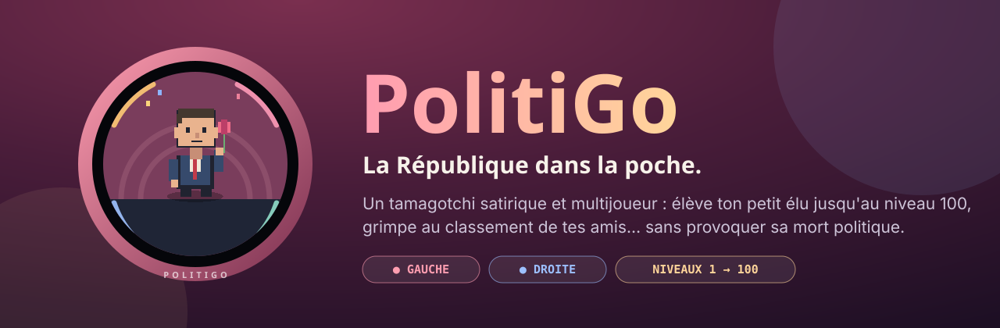
</p>

<p align="center">
  <a href="LICENSE"></a>
  
  
  
  
  
</p>

<p align="center">
  <b>Un tamagotchi satirique et multijoueur sur la politique française.</b><br>
  Choisis ton camp, élève ton petit élu de niveau 1 à 100, fais-le évoluer de figure en figure,<br>
  et grimpe au classement de tes amis… sans provoquer sa <i>mort politique</i>.
</p>

---

## 🎬 Aperçu

| Ton élu | Choisir son camp | Le tableau de bord |
|:---:|:---:|:---:|
| 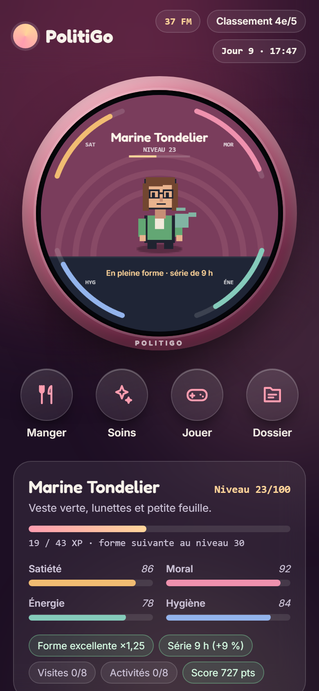 | 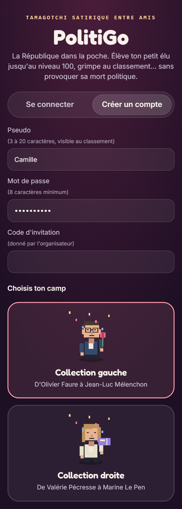 |  |

<p align="center">
  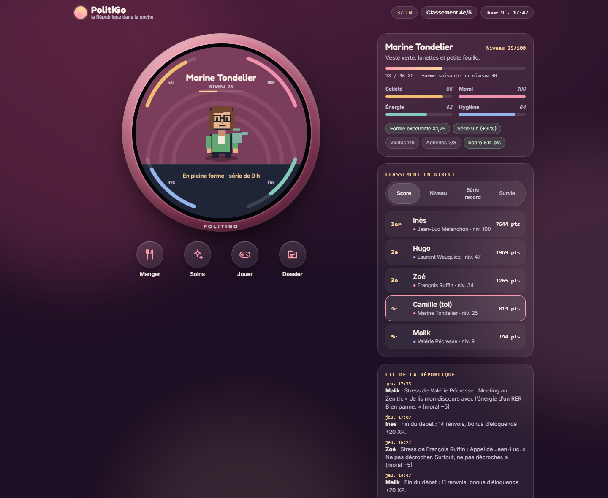
</p>

| La Buvette | Jouer | Pong des arguments |
|:---:|:---:|:---:|
| 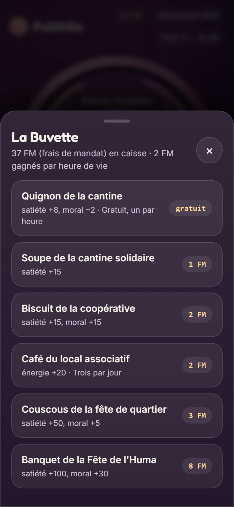 | 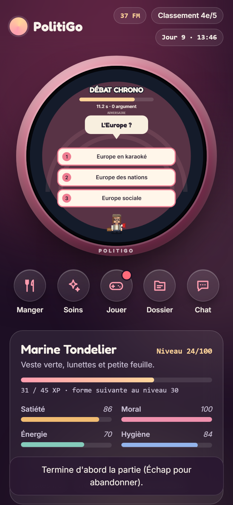 | 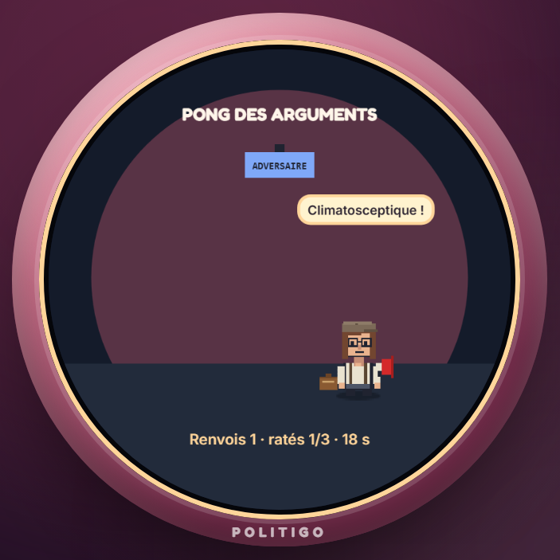 |

| Passation de pouvoir | Mort politique, à gauche | Mort politique, à droite |
|:---:|:---:|:---:|
| 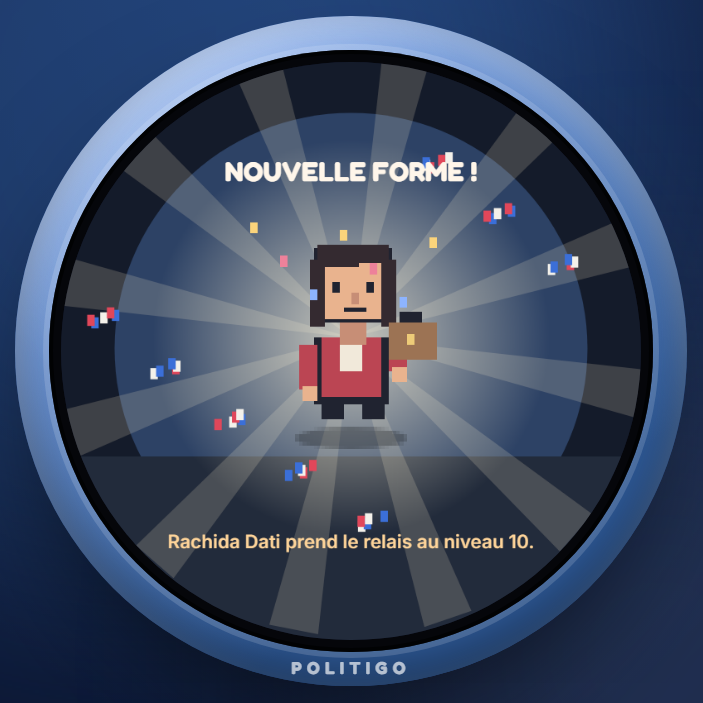 | 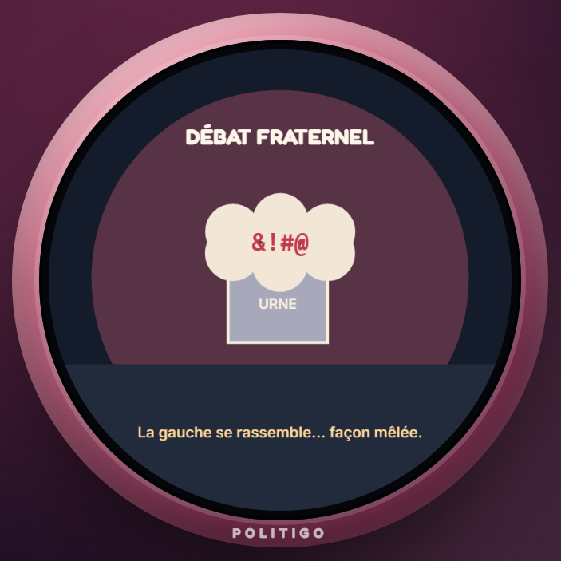 | 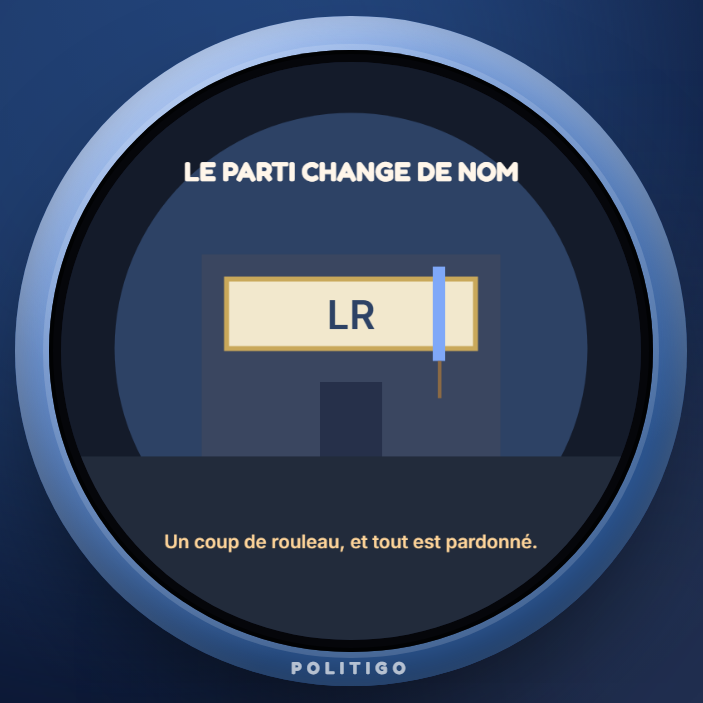 |

---

## 🗳️ C'est quoi ?

**PolitiGo** reprend le principe du tamagotchi : un petit compagnon qu'il faut nourrir, soigner, distraire… et surtout ne pas
oublier. Sauf qu'ici, le compagnon est **un élu**, dessiné en pixel art, et qu'il change de visage tous les dix niveaux.

On joue **entre amis**, chacun sur son téléphone : un serveur fait tourner toutes les parties en **temps réel**, et un
**classement en direct** départage les meilleurs éleveurs de la République.

### Deux collections, vingt figures

Au début, tu choisis un camp. Indécis ? Laisse faire le **hasard** 🎲, ou passe ton **test politique** :
cinq questions bien salées (« Un milliardaire s'offre un troisième yacht. Ta réaction ? »), trois réponses chacune,
et le test te propose ton camp. Libre à toi de rejoindre l'autre bord.
Ton élu traverse ensuite sa collection, une nouvelle figure tous les 10 niveaux, jusqu'à la **légende** du niveau 100.

| Niveaux | 🌹 Collection gauche | 🔵 Collection droite |
|:---:|---|---|
| 1 – 9 | Olivier Faure | Valérie Pécresse |
| 10 – 19 | Raphaël Glucksmann | Rachida Dati |
| 20 – 29 | Marine Tondelier | Xavier Bertrand |
| 30 – 39 | François Ruffin | Édouard Philippe *(qui grisonne puis se dégarnit au fil des niveaux)* |
| 40 – 49 | Fabien Roussel | Laurent Wauquiez |
| 50 – 59 | Nathalie Arthaud | Bruno Retailleau |
| 60 – 69 | Sandrine Rousseau | Éric Ciotti |
| 70 – 79 | Philippe Poutou | Marion Maréchal |
| 80 – 89 | Mathilde Panot | Jordan Bardella |
| 90 – 100 | Jean-Luc Mélenchon | Marine Le Pen |

<p align="center">
  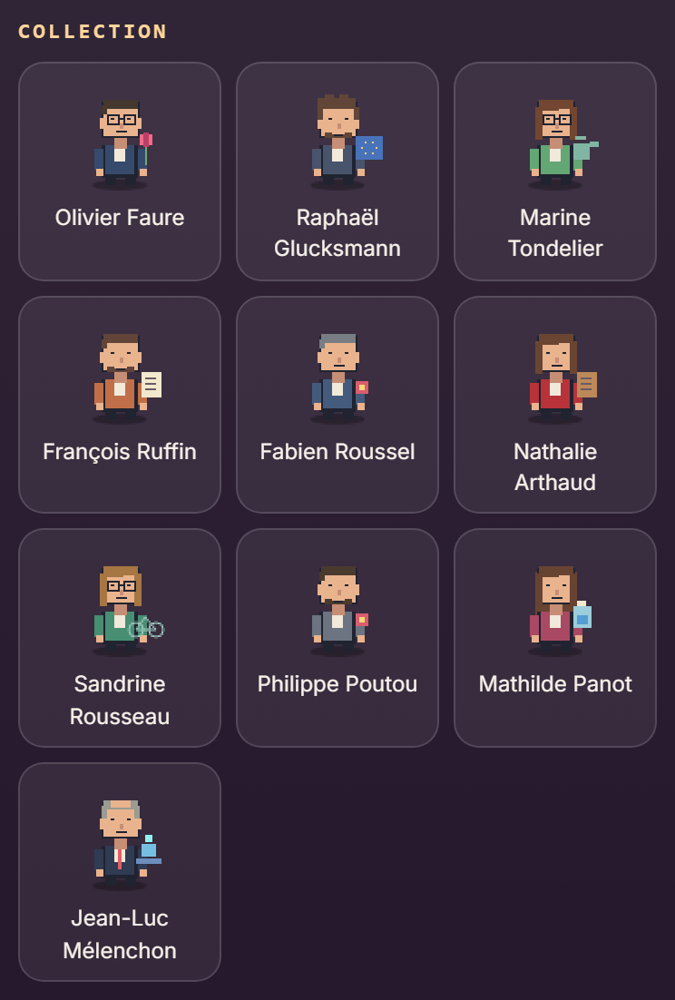
  &nbsp;
  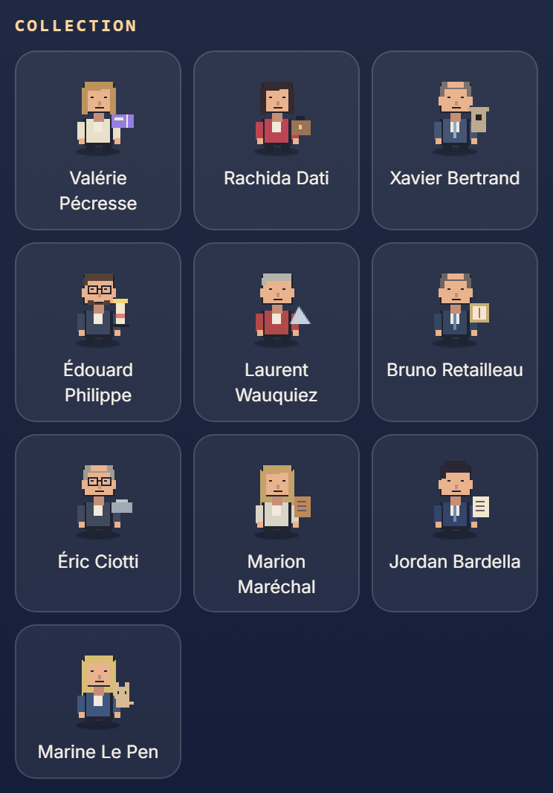
</p>

<p align="center">
  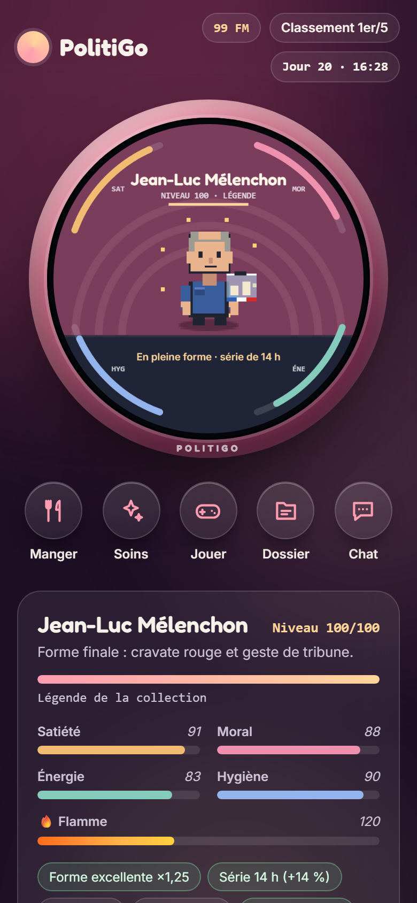<br>
  <sub>Niveau 100 : ton élu entre dans la légende… ou dans les manuels.</sub>
</p>

---

## 🎮 Comment ça marche

### Quatre jauges à surveiller

| | Jauge | Elle baisse… | On la remonte avec… |
|:---:|---|---|---|
| 🍞 | **Satiété** | à chaque heure, surtout éveillé | la Buvette : du quignon gratuit (qui fait un peu grimacer) au banquet |
| 💗 | **Moral** | avec le temps, la faim, la saleté… et les casseroles | les débats, le jardin, les douceurs, une tape sur l'épaule, le quitte ou double |
| ⚡ | **Énergie** | avec les heures éveillées et les activités | la nuit, la sieste, le hamac, le café (trois par jour) |
| 🫧 | **Hygiène** | doucement, heure après heure | le savon |

Une jauge **à zéro pendant 12 heures**, et c'est la **mort politique** : la partie repart au niveau 1, avec une animation
de renaissance propre à chaque camp (la *primaire unitaire* à gauche, *le parti change de nom* à droite).

### Le rythme d'une journée

- ⏰ **Le jeu suit l'heure réelle** (Paris). La nuit, de 0 h à 6 h, ton élu dort et récupère.
- 👋 **Passe le voir** : chaque visite rapporte de l'XP, une fois toutes les 2 heures, 8 fois par jour au maximum.
- 🎮 **Trois mini-jeux** : 2 activités par visite, 8 par jour, chacune +30 XP plus un bonus selon le score,
  d'autant plus gros que le jeu est difficile : **10 XP** au plus pour le Pong, **20** pour le Débat chrono, **30** pour la Manif.
  - 🎤 **Débat chrono** : 15 secondes pour enchaîner les réponses de ta ligne, tirées dans le désordre parmi 32 questions.
    « Programme économique ? » : à gauche on taxe les riches, à droite les pauvres, et « taxer les politiques » est hors sujet pour tout le monde.
    Une erreur coûte une seconde.
  - ✊ **Manif**, un jeu par camp. À gauche, **Le Cortège** : tiens le défilé de République à Nation en esquivant LBD et lacrymo,
    avec un parapluie pour parer. À droite, **L'Épervier** : interpelle les manifestants avec ton CRS, esquive pavés et molotovs,
    et gare aux journalistes et aux collègues infiltrés, qui coûtent des points.
  - 🏓 **Pong des arguments** : renvoie les piques de l'adversaire pendant 20 secondes.
- 🎲 **Quitte ou double** : juste après un débat, une revanche à pile ou face. Gagnée : moral **+12** et énergie **+12**.
  Perdue : un **stress ×2**.
- 💼 **Frais de mandat (FM)** : la monnaie du jeu, 2 FM gagnés par heure de vie. **Aucun achat réel, jamais.**
- 📈 **La forme compte** : bien soigné, il gagne de l'XP plus vite et enchaîne les séries. Négligé, il régresse.
  Avec six visites et quelques activités par jour, le niveau 100 se gagne en une quinzaine de jours,
  un peu moins si tu brilles aux mini-jeux.

### Les casseroles

Chaque personnage traîne **deux casseroles** : des stress qui tombent au hasard, plus souvent quand son moral est bas.
Chacune fait un clin d'œil à un **fait public** (un score électoral, une petite phrase, une procédure, avec son stade exact),
et toutes sont recensées, avec leurs références, dans **[docs/SOURCES.md](docs/SOURCES.md)**.

### Entre amis

- 🏆 **Classement en direct** : score, niveau, série record, survie.
- ⚔️ **Duels** : défie un autre élu au Débat chrono. Mêmes questions pour les deux, le meilleur score gagne.
  Tu joues d'abord, ton rival a 24 h pour relever le défi ou le refuser (sans rien perdre).
  Victoire : **+40 XP**, moral +10, énergie +5. Défaite : −15 XP, moral −10, énergie −5, sans jamais perdre de niveau
  ni descendre une jauge sous 25. Dès le niveau 5, trois défis par jour.
- 🔔 **Notifications** : sois prévenu d'un défi ou d'un résultat même le jeu fermé (Dossier → Compte).
  Sur iPhone, ajoute d'abord PolitiGo à l'écran d'accueil.
- 📰 **Fil de la République** : les évolutions, les morts politiques et les beaux scores aux mini-jeux et les duels de chacun, en temps réel.
- 🔐 **Sur invitation** : un code donné par l'organisateur, et le nombre de comptes plafonné.

---

## 🛠️ Sous le capot

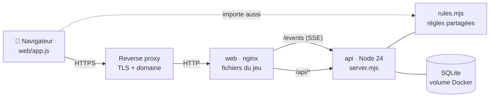

- **Le serveur fait foi.** Il détient les parties, fait tourner l'horloge de chacun (même page fermée) et vérifie chaque
  action. Le navigateur affiche et anime, il ne décide rien.
- **Les mêmes règles des deux côtés** : `web/rules.mjs` est importé par le navigateur et par le serveur.
- **Temps réel** par Server-Sent Events : le classement et le fil se mettent à jour sans recharger la page.
- **Zéro dépendance** : Node 24 seul (`node:http`, `node:sqlite`, `node:crypto`), aucun `npm install`.
- **Robuste aux maintenances** : après un arrêt, même de plusieurs jours, chaque partie revient sur l'heure réelle, sans
  que les jauges bougent ; personne ne meurt parce que le serveur était éteint.
- **Sécurité** : mots de passe hachés (scrypt), cookies `__Host-`, protection CSRF, limites de tentatives, CSP stricte sans
  `unsafe-inline`, conteneurs non-root en lecture seule et sans capacités. Le détail est dans le [guide technique](docs/DEPLOIEMENT.md#4-sécurité-en-bref).

---

## 🚀 Installer sa partie

Il faut un serveur avec Docker. Les images sont publiées sur le registre GitHub, pour `amd64` et `arm64`.

```bash
git clone https://github.com/MonXBZH/politigo.git && cd politigo
cp .env.example .env          # POLITIGO_BIND = l'IP du serveur, le reste convient pour commencer
docker compose up -d --build
docker compose logs api       # le code d'invitation à donner aux amis s'y affiche
```

Puis place-le derrière ton reverse proxy en HTTPS. Pour un simple essai en local, sans proxy ni HTTPS, mets
`COOKIE_SECURE=0` et `PROXY_HOPS=1` dans `.env` : sinon le navigateur refuse le cookie de session. Le **[guide technique](docs/DEPLOIEMENT.md)** détaille tout :
les variables, la configuration nginx du reverse proxy, le pare-feu, la stack **Portainer** avec les images prêtes,
les sauvegardes, les mises à jour, le cycle de développement et les tests.

---

## 🤝 Contribuer

- Le travail se fait sur la branche **`dev`** ; `main` ne reçoit que des pull requests, et publie les images.
- Chaque pull request passe la batterie de tests (`bash tests/run-server.sh`, dans l'image Node de production).
- **Un fait dépassé, une procédure qui a évolué ?** Ouvre une *issue* : l'exactitude des références passe avant tout.
  Les références vivent dans `web/rules.mjs`, et `docs/SOURCES.md` se régénère avec `tools/make-sources.mjs`.

---

## 🙏 Crédits

- **L'idée** vient de [TamaDigi](https://github.com/MonXBZH/TamaDigi), un V-Pet pour ESP32 à écran rond, lui-même issu du
  moteur [TamaPoke](https://github.com/socquique/TamaPoke) de Quique Tortosa. PolitiGo en reprend l'esprit et le format
  (l'écran rond de 466 px), mais c'est une réécriture complète pour le web : aucun code n'en provient.
- **Polices** : [Fredoka](https://github.com/hafontia/Fredoka-One) (The Fredoka Project Authors) et
  [Inter](https://github.com/rsms/inter) (The Inter Project Authors), sous licence SIL Open Font License 1.1
  ([Fredoka](web/fonts/OFL-fredoka.txt), [Inter](web/fonts/OFL-inter.txt)), servies depuis le jeu lui-même.
- **Dessins** : tous les sprites sont originaux, tracés pixel par pixel dans le code (aucune image importée).

---

## ⚠️ Avertissements

> **PolitiGo est une œuvre satirique.** Il relève de la parodie et de la caricature, et n'a d'autre but que de faire sourire.

- **Aucune affiliation** avec les personnes, partis ou institutions évoqués, et **aucune prise de position** : les deux camps
  sont traités sur un pied d'égalité, et ni le jeu ni ses auteurs n'appellent à voter pour qui que ce soit.
- **Les répliques sont inventées ou librement adaptées**, jamais présentées comme des citations exactes ; le jeu n'a aucune
  valeur d'information.
- **Les faits évoqués sont publics** et accompagnés de leur source ([docs/SOURCES.md](docs/SOURCES.md)). Quand une procédure
  judiciaire est citée, c'est avec son stade exact au moment de l'écriture : **la présomption d'innocence s'applique** à
  toute personne qui n'a pas été définitivement condamnée.
- **Les dessins sont des caricatures originales**, sans photo ni logo officiel.
- **Aucun argent réel** : la seule monnaie, les frais de mandat, se gagne en gardant son élu en vie.
- **Données** : seuls le pseudo, le mot de passe haché et la partie sont enregistrés, sur le serveur de l'organisateur.
  Chaque joueur peut supprimer son compte depuis Dossier → Compte.
- **Une personne citée estime un contenu inexact ou blessant ?** Ouvre une *issue* sur ce dépôt : il sera revu, corrigé ou
  retiré sans discussion.

---

## 📄 Licence

Le code et les dessins sont sous licence **[MIT](LICENSE)**. Les polices restent sous leur propre licence (SIL OFL 1.1).
Les noms des personnes, partis et institutions cités appartiennent à leurs titulaires ; aucun droit n'est revendiqué dessus.

<p align="center"><sub>Fait avec 🌹, 🔵 et beaucoup de café de la permanence.</sub></p>
